# Reto 5 — Proteger una aplicación Symfony

**Alumno:** Judit Giravent
**Fecha:** Octubre 2026
**Repositorio:** @everest9957

---

## 📖 Descripción del reto

El objetivo de este reto es **proteger una aplicación Symfony existente** aplicando
autenticación y autorización robustas mediante el **componente de seguridad de Symfony**.

La aplicación implementa una **banca online** ("Mi Banco") con:
- Usuarios con roles (`ROLE_USER`, `ROLE_ADMIN`)
- Cuentas bancarias
- Movimientos entre cuentas
- Panel de administración
- Control de acceso granular mediante **Voter**

---

## 🛠️ Entorno utilizado

| Herramienta | Versión |
|---|---|
| PHP | 8.4.25 |
| Composer | 2.10.3 |
| Symfony CLI | 5.20.0 |
| Symfony | 7.x |
| Base de datos | SQLite |
| Servidor | Symfony CLI (PHP-CGI) |
| Sistema operativo | Windows 11 |
| Editor | Visual Studio Code |
| Testing | PHPUnit 13 |

---

## 📸 Capturas del proceso

### FASE 0 — Verificación del entorno

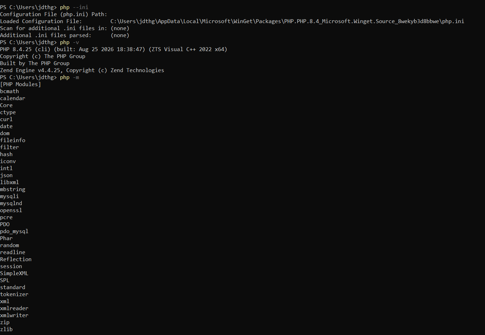

**Descripción:** Verificación de `php -v` y `php -m` tras corregir la configuración
del `php.ini` (que apuntaba a una instalación antigua de PHP 7.4). Se activaron las
extensiones `curl`, `intl`, `mbstring`, `openssl`, `pdo_sqlite`, `pdo_mysql`, `zip`
y `fileinfo`.

---

### FASE 1 — Creación del proyecto Symfony

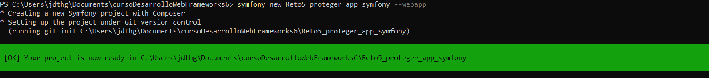
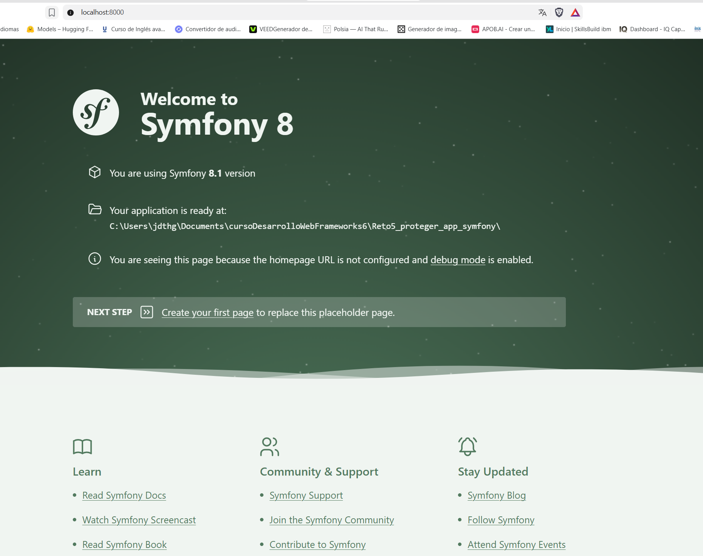

**Descripción:** Creación del proyecto con `symfony new Reto5_proteger_app_symfony --webapp`.
La segunda captura muestra la pantalla de bienvenida de Symfony.

---

### FASE 2 — Entidades y base de datos

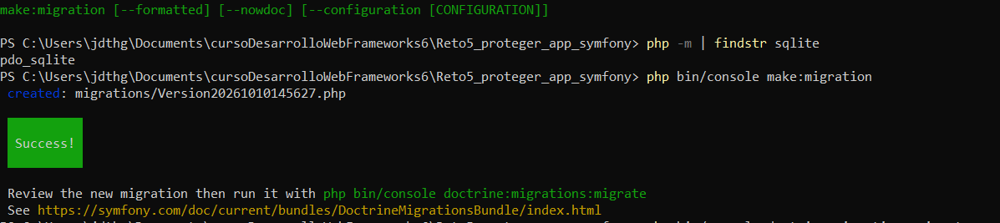
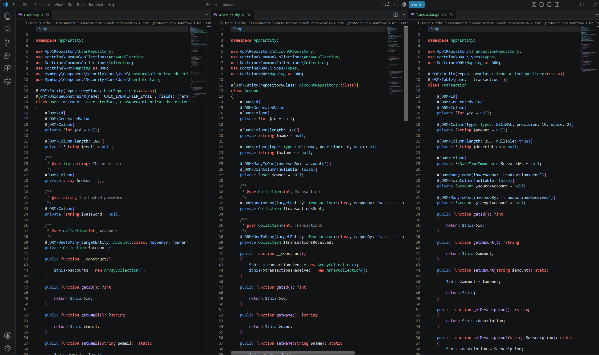
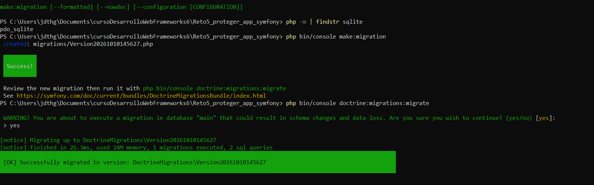
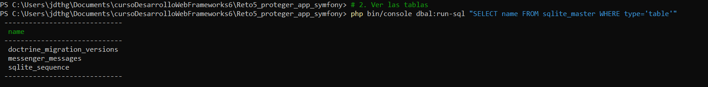

**Descripción:** Configuración de SQLite, creación de las entidades `User`, `Account`
y `Transaction`, generación de migraciones y creación de las tablas en la BD.

**Nota sobre SQLite:** el comando `doctrine:database:create` no es compatible con
SQLite (crea el archivo `.db` automáticamente al primer acceso). Se omitió y se
procedió directamente con las migraciones.

---

### FASE 3 — Autenticación

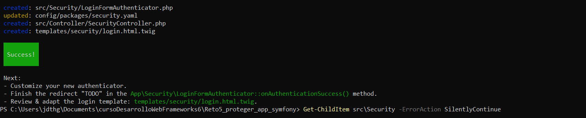
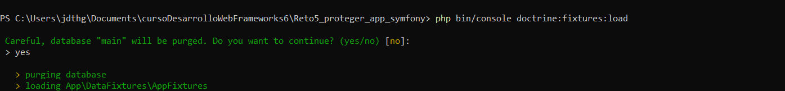
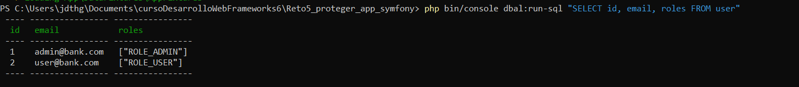
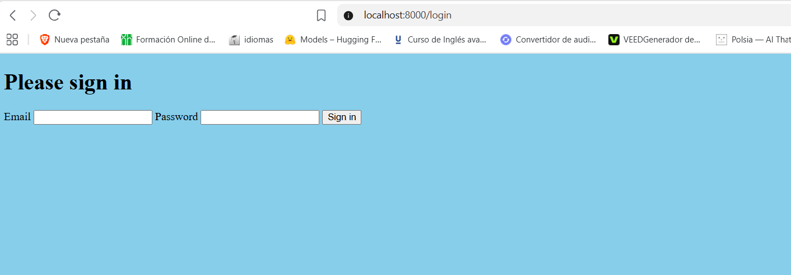
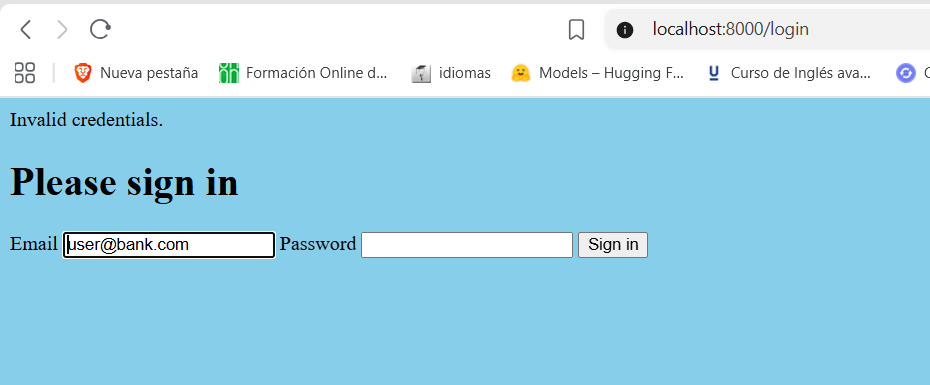
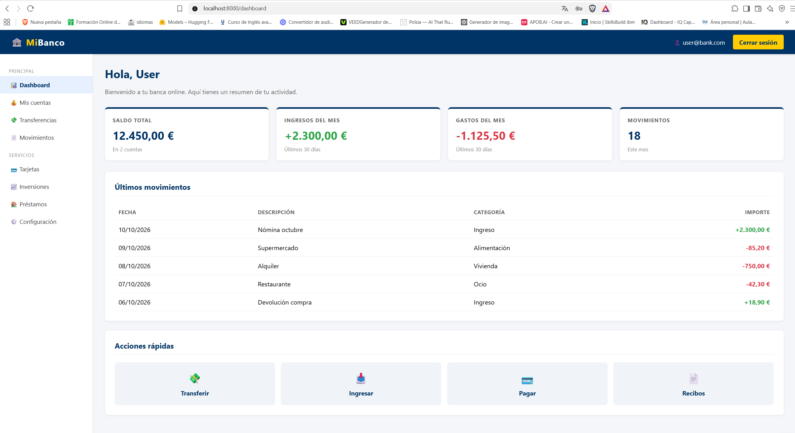
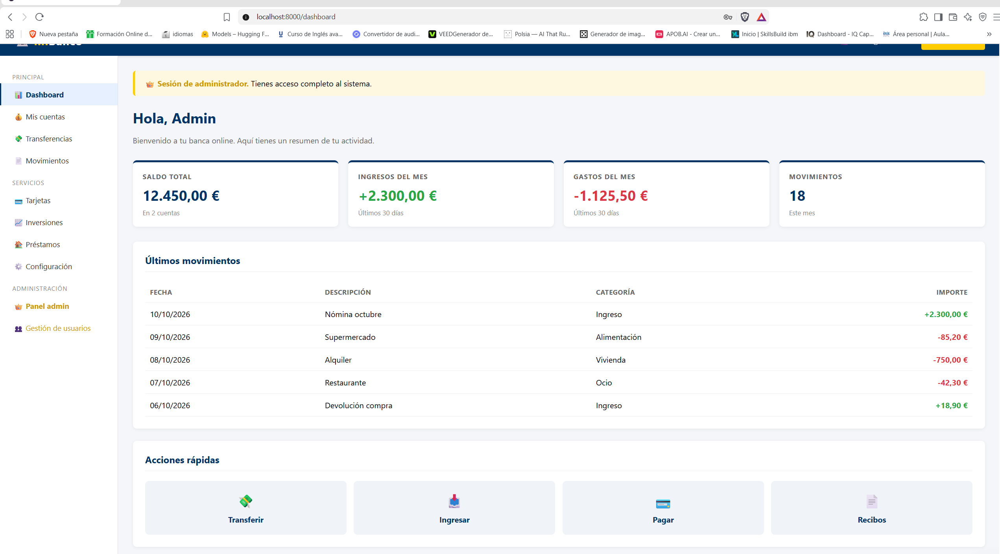
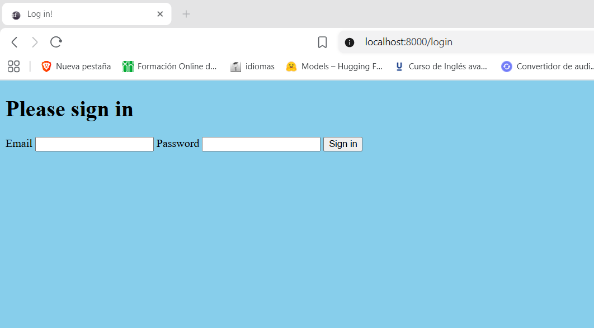

**Descripción:** Configuración del firewall, creación del formulario de login/logout
con `make:auth`, generación de usuarios de prueba mediante fixtures y pruebas de
login correcto/incorrecto, dashboard diferenciado por rol, y logout redirigiendo
a `/login`.

**Usuarios de prueba:**

| Email | Contraseña | Rol |
|---|---|---|
| `admin@bank.com` | `admin123` | `ROLE_ADMIN` |
| `user@bank.com` | `user123` | `ROLE_USER` |

---

### FASE 4 — Autorización

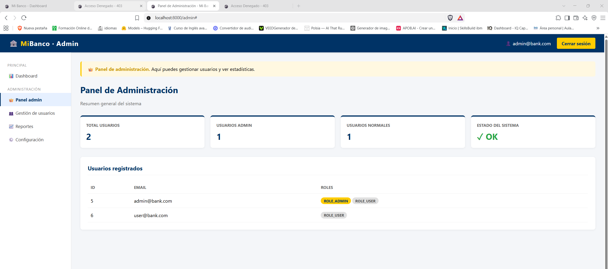
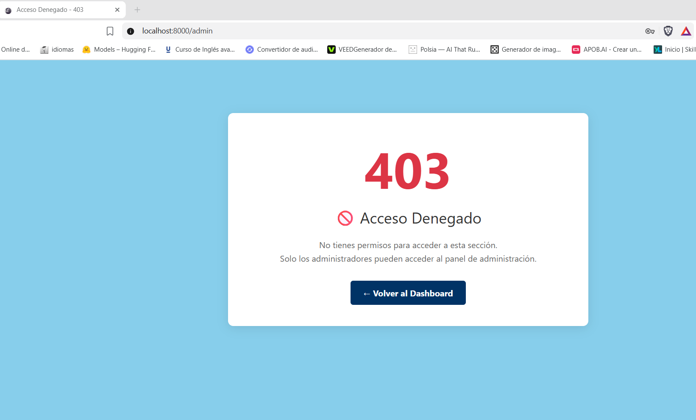
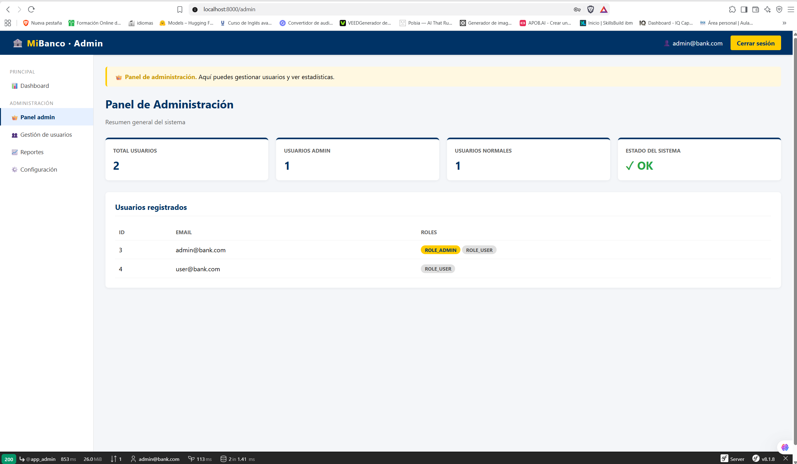
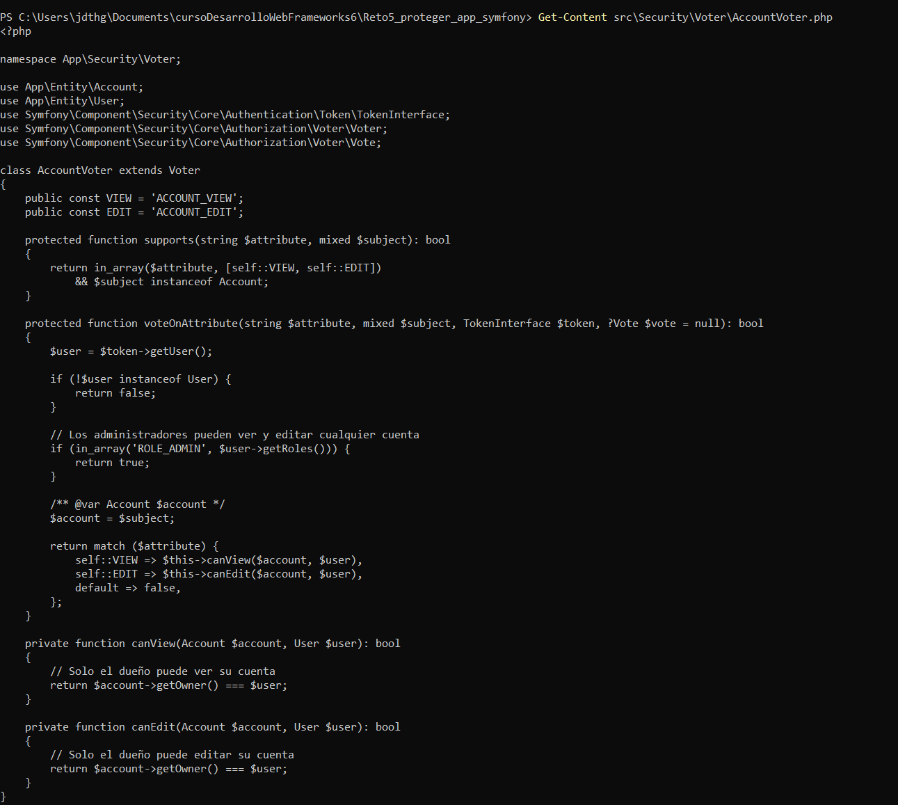
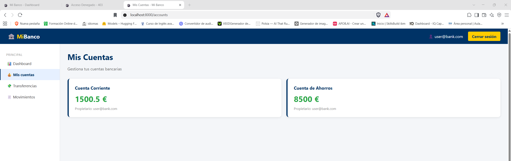
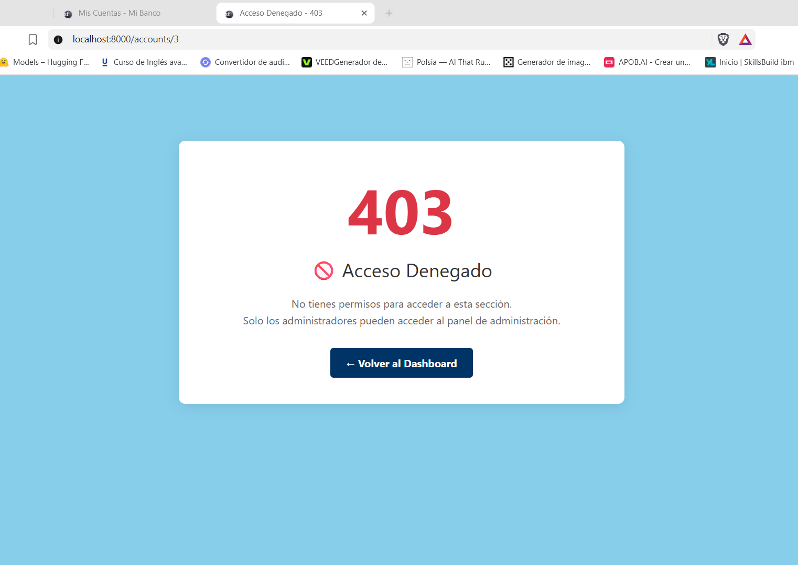

**Descripción:** Implementación de autorización en dos niveles:

1. **Autorización por roles** (`ROLE_ADMIN`, `ROLE_USER`) mediante `access_control`
   y el atributo `#[IsGranted]`. Se configuró `access_denied_url: /acceso-denegado`
   para mostrar una página 403 personalizada.

2. **Autorización por objeto (Voter):** el `AccountVoter` verifica que un usuario
   solo pueda ver sus propias cuentas. Los administradores pueden verlas todas.

---

### FASE 5 — Pruebas de seguridad

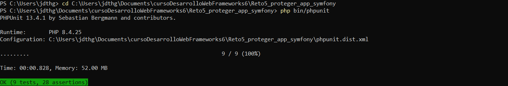

**Descripción:** Suite de 9 tests automatizados con PHPUnit que cubren:

| Test | Qué verifica |
|---|---|
| `testLoginPageIsAccessible` | `/login` accesible sin autenticación |
| `testDashboardRequiresAuthentication` | Sin login → redirige a `/login` |
| `testLoginWithValidCredentials` | Login correcto → `/dashboard` |
| `testLoginWithInvalidCredentials` | Login incorrecto → error |
| `testUserCannotAccessAdminPanel` | User → `/admin` → 403 |
| `testAdminCanAccessAdminPanel` | Admin → `/admin` → OK |
| `testUserCanViewOwnAccounts` | User → `/accounts` → OK |
| `testUserCannotViewOtherUsersAccount` | User → cuenta ajena → 403 |
| `testAdminCanViewAnyAccount` | Admin → cualquier cuenta → OK |

Resultado: **OK (9 tests, 28 assertions)**

---

## 🔐 Detalles técnicos de seguridad

### 1. Autenticación (`config/packages/security.yaml`)

```yaml
security:
    password_hashers:
        Symfony\Component\Security\Core\User\PasswordAuthenticatedUserInterface: 'auto'

    providers:
        app_user_provider:
            entity:
                class: App\Entity\User
                property: email

    firewalls:
        dev:
            pattern: ^/(_profiler|_wdt|assets|build)/
            security: false
        main:
            lazy: true
            provider: app_user_provider
            custom_authenticator: App\Security\LoginFormAuthenticator
            access_denied_url: /acceso-denegado
            logout:
                path: app_logout
                target: app_login
```

Componentes clave:

password_hashers: algoritmo automático (auto) para hashear contraseñas.

providers: el proveedor busca usuarios por email en la BD.

custom_authenticator: autenticador personalizado creado con make:auth.

logout.target: redirige a /login tras cerrar sesión.

```yaml

    access_control:
        - { path: ^/login, roles: PUBLIC_ACCESS }
        - { path: ^/logout, roles: PUBLIC_ACCESS }
        - { path: ^/acceso-denegado, roles: PUBLIC_ACCESS }
        - { path: ^/admin, roles: ROLE_ADMIN }
        - { path: ^/dashboard, roles: ROLE_USER }
```

3. #[IsGranted] a nivel de controlador
php
#[Route('/admin')]
#[IsGranted('ROLE_ADMIN')]
final class AdminController extends AbstractController
{
    // ...
}
4. Voter personalizado — AccountVoter
El Voter decide si un usuario puede ver o editar una cuenta concreta:

php
class AccountVoter extends Voter
{
    public const VIEW = 'ACCOUNT_VIEW';
    public const EDIT = 'ACCOUNT_EDIT';

    protected function supports(string $attribute, mixed $subject): bool
    {
        return in_array($attribute, [self::VIEW, self::EDIT])
            && $subject instanceof Account;
    }

    protected function voteOnAttribute(string $attribute, mixed $subject, TokenInterface $token, ?Vote $vote = null): bool
    {
        $user = $token->getUser();
        if (!$user instanceof User) return false;

        // Los administradores pueden ver y editar cualquier cuenta
        if (in_array('ROLE_ADMIN', $user->getRoles())) return true;

        /** @var Account $account */
        $account = $subject;

        return match ($attribute) {
            self::VIEW => $this->canView($account, $user),
            self::EDIT => $this->canEdit($account, $user),
            default => false,
        };
    }

    private function canView(Account $account, User $user): bool
    {
        return $account->getOwner() === $user;
    }

    private function canEdit(Account $account, User $user): bool
    {
        return $account->getOwner() === $user;
    }
}
Invocación en el controlador:

php
$this->denyAccessUnlessGranted('ACCOUNT_VIEW', $account);
Si el Voter devuelve false, Symfony lanza un AccessDeniedException y redirige a
/acceso-denegado (configurado en el firewall).

5. Gestión de roles
Los roles se almacenan en la columna roles de la tabla user como un array JSON.
Ejemplo: ["ROLE_ADMIN"] o ["ROLE_USER"].

En las fixtures se crean dos usuarios de prueba con roles diferenciados.

📂 Estructura del proyecto
text
Reto5_proteger_app_symfony/
├── config/
│   └── packages/
│       ├── security.yaml           ← Configuración de seguridad
│       └── doctrine.yaml           ← Configuración de BD
├── docs/
│   ├── README.md                   ← Este documento
│   └── capturas/                   ← Capturas por fase
├── migrations/                     ← Migraciones de Doctrine
├── public/                         ← Punto de entrada
├── src/
│   ├── Controller/
│   │   ├── AccessDeniedController.php
│   │   ├── AccountController.php
│   │   ├── AdminController.php
│   │   ├── DashboardController.php
│   │   └── SecurityController.php
│   ├── DataFixtures/
│   │   └── AppFixtures.php
│   ├── Entity/
│   │   ├── Account.php
│   │   ├── Transaction.php
│   │   └── User.php
│   ├── Repository/
│   ├── Security/
│   │   ├── LoginFormAuthenticator.php
│   │   └── Voter/
│   │       └── AccountVoter.php
│   └── Kernel.php
├── templates/
│   ├── access_denied/
│   ├── account/
│   ├── admin/
│   ├── dashboard/
│   └── security/
└── tests/
    └── SecurityTest.php
🚀 Cómo ejecutar el proyecto
powershell
# 1. Clonar
git clone https://github.com/TU_USUARIO/Reto5_proteger_app_symfony.git
cd Reto5_proteger_app_symfony

# 2. Instalar dependencias
composer install

# 3. Configurar BD (SQLite)
# En .env: DATABASE_URL="sqlite:///%kernel.project_dir%/var/data.db"

# 4. Crear la BD y tablas
php bin/console doctrine:migrations:migrate

# 5. Cargar usuarios de prueba
php bin/console doctrine:fixtures:load

# 6. Arrancar
symfony serve
Abrir en el navegador: http://localhost:8000

Credenciales:

Admin: admin@bank.com / admin123

User: user@bank.com / user123

🧪 Cómo ejecutar los tests
powershell
php bin/phpunit
Resultado esperado: OK (9 tests, 28 assertions)

📚 Aprendizajes clave
Componente de seguridad de Symfony: configuración de firewalls, providers,
password hashers, y access controls.

Autenticadores personalizados: creación con make:auth y personalización
del redirect tras login exitoso.

Autorización en dos niveles:

Por roles (access_control + #[IsGranted])

Por objeto (Voters personalizados)

Páginas de error personalizadas: access_denied_url + plantilla Twig.

Testing de seguridad: 9 tests automatizados con PHPUnit que verifican
autenticación y autorización a distintos niveles.

Gestión de usuarios y roles: fixtures con UserPasswordHasherInterface.

✅ Conclusión
El reto ha sido completado satisfactoriamente. La aplicación Symfony está protegida
con autenticación robusta y autorización granular a nivel de rol y de objeto, con
una suite de tests automatizados que valida el comportamiento esperado del sistema
de seguridad.
